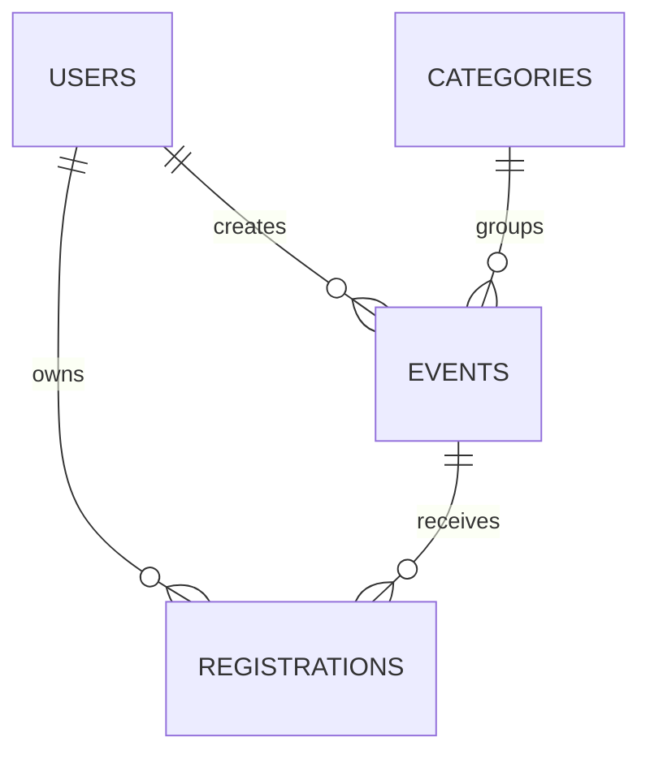

# Verilənlər bazası modeli

Faktiki icra olunan DDL: `app/schema.sql`. Baza `instance/events.sqlite3` yolunda başlanğıcda yaradılır.

| Cədvəl | Sahələr və açarlar |
|---|---|
| users | id INTEGER PK; name TEXT NOT NULL; email TEXT NOT NULL UNIQUE COLLATE NOCASE; password_hash TEXT NOT NULL; role TEXT NOT NULL CHECK student/admin |
| categories | id INTEGER PK; name TEXT NOT NULL UNIQUE |
| events | id INTEGER PK; title, description, starts_at, location TEXT NOT NULL; category_id FK; capacity INTEGER CHECK >0; created_by FK |
| registrations | id INTEGER PK; user_id FK; event_id FK; created_at TEXT DEFAULT CURRENT_TIMESTAMP; UNIQUE(user_id,event_id) |

Bir kateqoriyanın çox tədbiri ola bilər, hər tədbirin bir kateqoriyası olur. İstifadəçi və tədbir arasında çoxdan-çoxa əlaqəni `registrations` həll edir. `created_by` tədbiri yaradan hesabın kimliyini saxlayır; admin olma tələbi API qatındadır.

## Bütövlük

- FK-lər mövcud olmayan istifadəçiyə, tədbirə və ya kateqoriyaya bağlanmağı bloklayır. Hər bağlantıda `PRAGMA foreign_keys=ON` verilir.
- `UNIQUE(user_id,event_id)` bir istifadəçinin eyni tədbirə təkrar qeydiyyatını bloklayır.
- `registration_capacity` INSERT trigger-i limit dolduqda qeydiyyatı dayandırır.
- `capacity_floor` UPDATE trigger-i tutumu artıq qeydiyyatdan keçmiş saydan aşağı salmağa icazə vermir.
- Tədbir və ya istifadəçi silindikdə onun qeydiyyatları `ON DELETE CASCADE` ilə silinir. İstifadəçinin silinməsi üçün UI/API yoxdur; tədbir yaratmış istifadəçinin silinməsinə `events.created_by` əlaqəsi mane ola bilər.
- Kateqoriya istifadə edilirsə onun silinməsi FK tərəfindən bloklanır. Kateqoriyalar hazır siyahıdır; kateqoriya CRUD bu tapşırıqda tələb edilməyib.
- E-poçt serverdə kiçik hərflərə çevrilir və bazada NOCASE UNIQUE ilə qorunur.
- Boş mətn, tarix formatı, gələcək tarix və maksimum tutum tətbiq qatında yoxlanır. Bazada NOT NULL boş sətiri özü bloklamır. Birbaşa DB müdaxiləsi üçün tam tarix validasiyası iddia edilmir.
- Tarixlər `YYYY-MM-DDTHH:MM` kimi Bakı divar saatı ilə saxlanır; buna görə format standart saxlananda mətn sıralaması xronoloji sıralamaya uyğundur.
- `registrations.event_id` və `events.starts_at` üzərində indeks var. Unikal cüt üçün ayrıca SQLite avtomatik indeks yaradır.

## Niyə təkrar məlumat saxlanmır?

Tədbir kateqoriyasının adı hər tədbir sətrinə kopyalanmır. İstifadəçinin adı hər qeydiyyatda təkrar yazılmır. İştirakçı sayı saxlanılan ayrıca sütun deyil, COUNT ilə hesablanır. Beləliklə ləğv və silmə zamanı yanlış köhnə say qalması riski azaldılır.

## Tranzaksiya nümunəsi

İki istifadəçi son yerə eyni vaxtda müraciət etdikdə birinci yazı tranzaksiyası yeri tutur. İkinci sorğu gözlədikdən sonra dolmuş limitlə qarşılaşır. Testdə bir cavab 201, digəri 409 olub. SQLite-da eyni anda yalnız bir yazı tranzaksiyası mümkündür; çox yüksək yükdə gözləmə və SQLITE_BUSY yarana bilər. Hazır versiya ümumi xəta mesajı verir, ayrıca retry strategiyası yoxdur.
