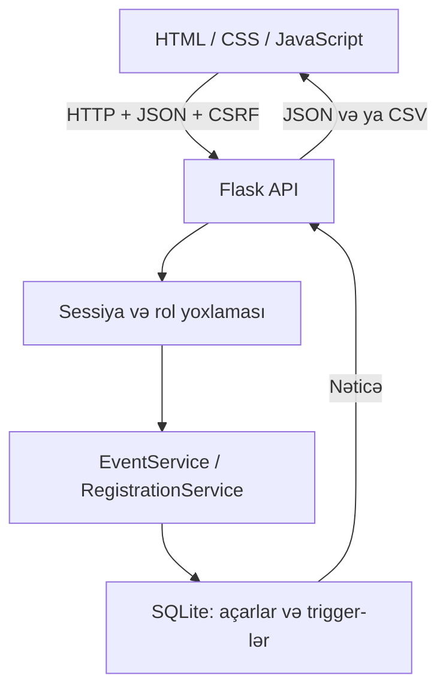

# Texniki sənəd

## Məqsəd və istifadəçi rolları

Universitet tədbirlərinin vahid kataloqunu yaratmaq, iştirakçıların qeydiyyatını idarə etmək və nəticələri admin panelində göstərmək. Qonaq kataloqu görür və axtarır. Tələbə hesabla daxil olduqdan sonra qeydiyyatdan keçir, öz qeydiyyatlarını görür və ləğv edir. Admin əlavə olaraq tədbirləri idarə edir, statistikanı və iştirakçı CSV faylını əldə edir. İctimai qeydiyyat həmişə `student` rolu yaradır; sorğudan admin rolu qəbul edilmir.

## Texnologiyaların seçimi

| Texnologiya | Səbəb | Alternativ və kompromis |
|---|---|---|
| Python 3.11+ / Flask 3.1.2 | Kiçik API, aydın marşrutlar, tətbiq fabriki və test client | Django daha çox hazır modul verir, amma kursun bu həcmi üçün əlavə quruluş yaradır |
| HTML5 / CSS / JavaScript | Brauzerdə işləyir, `fetch` ilə real API sorğuları; build mərhələsi yoxdur | React böyük interfeysdə komponent təkrarını asanlaşdırar, amma ayrıca alət zənciri tələb edir |
| SQLite / Python sqlite3 | Ayrı DB serveri olmadan əlaqəli cədvəllər və tranzaksiyalar | PostgreSQL daha çox paralel yazı və server idarəetməsi üçün uyğundur |
| unittest | Python daxilindədir; HTTP və DB inteqrasiya ssenarilərini yoxlayır | pytest daha geniş imkanlar verər, lakin məcburi deyil |
| Git | Real mənbə tarixçəsi, bərpa və remote-a push imkanı | ZIP təkbaşına commit tarixçəsini saxlamır; buna görə Git bundle əlavə edilib |

## Arxitektura

Brauzerdə `app.js` istifadəçi əməlindən sonra `/api/...` ünvanına HTTP sorğusu göndərir. Flask sorğunu, CSRF açarını, sessiyanı və rolu yoxlayır. Tədbir və qeydiyyat biznes qaydaları service qatında işləyir. DB bağlantısı parametrli SQLite sorğularını icra edir. Nəticə JSON cavabı kimi frontend-ə qaytarılır; JavaScript görünüşü yeniləyir. CSV endpoint-i JSON əvəzinə fayl verir.

`create_app` test zamanı ayrıca baza seçməyə imkan verir. `get_db` eyni sorğuda bağlantını təkrar istifadə edir; `teardown_appcontext` onu bağlayır. HTTP marşrutları request/response, service sinifləri biznes qaydaları, schema isə məlumat bütövlüyü üçün məsuldur.

## OOP, Clean Code və SOLID tətbiqi

`EventService` tədbirin yoxlanması və saxlanmasını, `RegistrationService` qeydiyyatı, `DomainError` isə istifadəçiyə göstərilən biznes xətalarını modelləşdirir. Siniflərin stateless olması səbəbindən metodlar static seçilib. Hər əməliyyat üçün süni class yaradılmayıb.

Single Responsibility service, DB və HTTP qatlarının ayrılmasında tətbiq edilir. Ortak giriş dekoratoru və `api()` funksiyası təkrarı azaldır. Flask konfiqurasiyasından test bazasının seçilməsi test edilə bilməni yaxşılaşdırır. Tam SOLID və ya strict dependency inversion iddiası yoxdur: service qatı `get_db` vasitəsilə SQLite-a bağlıdır. Böyük layihədə repository interface və dependency injection əlavə etmək olar. İrsiyyətin istifadəsinə ehtiyac olmadığına görə Liskov üçün süni iyerarxiya yaradılmayıb.

## Əsas API

| Metod / ünvan | İcazə | Nəticə |
|---|---|---|
| GET `/api/session` | Hər kəs | Cari istifadəçi və CSRF token |
| POST `/api/signup`, `/api/login`, `/api/logout` | CSRF ilə | Hesab və sessiya əməliyyatları |
| GET `/api/categories`, `/api/events` | Hər kəs | Kateqoriya və filtrli tədbirlər |
| POST `/api/events` | Admin | Yeni tədbir, 201 |
| PUT / DELETE `/api/events/{id}` | Admin | Redaktə / silmə |
| POST `/api/events/{id}/registration` | Daxil olmuş istifadəçi | Qeydiyyat, 201 |
| DELETE `/api/events/{id}/registration` | Qeydiyyat sahibi | Ləğv |
| GET `/api/stats` | Admin | Ümumi saylar, top 5, kateqoriyalar |
| GET `/api/events/{id}/participants.csv` | Admin | İştirakçı faylı |

Filtrlər: `q`, `category`, `location`, `from`, `to`, `mine=1`. Filtrlər birlikdə AND məntiqi ilə tətbiq edilir. `from` və `to` daxil olmaqla gün sərhədlərinə görə müqayisə aparılır. Saytda tarix formaları istifadə olunur; server filtr tarixlərinin formatını ayrıca sərt validasiya etmir, etibarsız filtr boş nəticə verə bilər.

## Qeydiyyat alqoritmi və təhlükəsizlik

1. Sessiya və CSRF, sonra tələb olunan səlahiyyət yoxlanır.
2. `BEGIN IMMEDIATE` qeydiyyatın check-and-insert hissəsini yazı tranzaksiyasına alır.
3. Tədbirin mövcudluğu, gələcək tarixdə olması və eyni istifadəçinin əvvəlki qeydiyyatı yoxlanır.
4. INSERT icra edilir; UNIQUE və trigger eyni bazada təkrar və tutum aşılmasını bloklayır.
5. Uğurda COMMIT, xətada ROLLBACK edilir.

SQL dəyərləri `?` parametrləri ilə ötürülür. Dinamik SQL-də sütun və operatorlar yalnız kodda müəyyən edilmiş sabit siyahıdan götürülür. Şifrələr Werkzeug hash funksiyası ilə saxlanır. Sessiya cookie-si HttpOnly və SameSite=Lax-dır. Dəyişdirən sorğular üçün CSRF token tələb edilir. HTML-ə çıxarılan istifadəçi mətnləri escape olunur. CSV formula başlanğıcları apostrofla neytrallaşdırılır. Böyük request həcmi 32 KiB ilə məhdudlaşdırılır. Gözlənilməyən xətanın detallarını server log-u saxlayır, istifadəçi sadə mesaj görür.

## Qəbul edilmiş davranışlar

- Tədbirin yaradılması və redaktəsində tarix gələcəkdə olmalıdır. Keçmiş tədbir görünür, silinə və ixrac edilə bilər; köhnə tarix saxlanaraq redaktə edilə bilməz. Bunun dəyişdirilməsi müəllimlə razılaşdırıla bilər.
- Silmə sərt silmədir və əlaqəli qeydiyyatları da silir; UI təsdiq istəyir.
- Qeydiyyat ləğvi keçmiş tədbir üçün də mümkündür; davamiyyət modulu yoxdur.
- Populyarlıq bərabərdirsə, tədbirin adı üzrə sıralanır. Qeydiyyatı olmayan tədbirlər top siyahıya düşə bilər.
- Təsdiq e-poçtu göndərilmir. Fərdi əlavə funksiya CSV ixracıdır və müəllimin tapşırığı ilə təsdiqlənməlidir.

## İstinadlar

2026-10-24 tarixində yoxlanılmış rəsmi mənbələr:
- Flask DB quruluşu və bağlantı lifecycle: https://flask.palletsprojects.com/en/stable/tutorial/database/
- SQLite tranzaksiyaları və BEGIN IMMEDIATE: https://www.sqlite.org/lang_transaction.html

Versiya seçimi ən yeni və ya ən təhlükəsiz versiya olduğu iddiası deyil; tələblər faylı bu mühitdə yoxlanmış Flask versiyasını saxlayır.
